# Sistema de Ventas e Inventario


[](https://github.com/AcuLuis/SistemaVentas/stargazers)

Aplicación de escritorio para gestionar las ventas de una tienda de tecnología: clientes, productos con control de stock, ventas con boleta en PDF, historial con anulaciones y reportes exportables a PDF y Excel. Está hecha en Python con **PyQt6** y usa **MySQL** como base de datos.

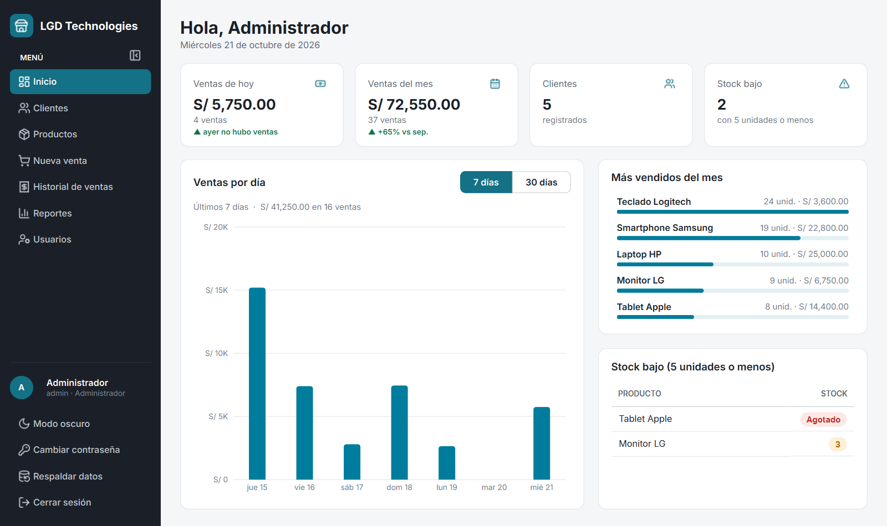

## Características

- **Inicio de sesión con roles.** Administrador y Vendedor, con contraseñas cifradas (PBKDF2), opción para ver la contraseña al escribirla y bloqueo temporal tras varios intentos fallidos.
  - Quien ingresa con una contraseña de ejemplo, o con una temporal que le asignó el administrador, debe cambiarla antes de entrar.
  - Tras unos minutos sin uso la pantalla se bloquea y pide la contraseña para seguir. Lo que estabas haciendo, como una venta a medias, queda tal cual.
- **Panel de inicio.**
  - Ventas del día y del mes comparadas con ayer y con el mismo tramo del mes anterior (▲ / ▼).
  - Gráfico de ventas por día de los últimos 7 o 30 días.
  - Ranking de los más vendidos y productos con stock bajo.
  - Cada tarjeta lleva a su detalle: las ventas de hoy o del mes abren el historial ya filtrado, y *Stock bajo* abre Productos con solo esos productos.
- **Clientes y productos.** Tabla con buscador y formulario en la misma pantalla. Valida DNI (8 dígitos), teléfono (9 dígitos), precios y DNI repetidos.
  - Al elegir un cliente se ve cuánto ha gastado, cuántas compras hizo y la fecha de la última, con un acceso a sus ventas en el historial.
  - En Productos, el filtro *Solo stock bajo* muestra lo que hay que reponer.
- **Stock seguro.** El stock no se escribe a mano: se ingresa o retira mercadería con un movimiento que suma o resta sobre el valor real, así nunca se pisa una venta hecha al mismo tiempo.
- **Ventas.**
  - El detalle se ve como un ticket: la cantidad se cambia en cada línea y se quita con una ✕.
  - Escribe o escanea el código del producto y pulsa Enter para agregarlo (funciona con lector de código de barras).
  - Registra un cliente nuevo sin salir de la venta, o vende a **Cliente varios** sin registrarlo (solo al contado).
  - Al contado calcula el vuelto a partir del monto recibido.
  - El stock se valida al agregar y otra vez al registrar, y todo se guarda en una sola transacción: si algo falla, no se registra nada.
- **Boleta.** Al registrar la venta puedes imprimirla directamente o guardarla en PDF; también desde el historial.
- **Historial de ventas.** Periodos rápidos (*Hoy*, *Esta semana*, *Este mes*, *Mes anterior*) o fechas a elección, filtro por estado y búsqueda por N° de venta, cliente o DNI. El detalle se ve como un recibo. El administrador puede anular una venta indicando el motivo: el stock se devuelve automáticamente y la venta queda marcada como anulada.
- **Reportes.**
  - Se actualizan solos al elegir el periodo, con los mismos periodos rápidos del historial.
  - Muestran el N° de ventas, el total vendido, el ticket promedio y un gráfico de ventas por día (o por mes en periodos largos).
  - Se pueden agrupar por venta, por producto o por vendedor.
  - Se exportan a **PDF** o **Excel** (con fechas y montos como valores reales y el total con fórmula).
- **Usuarios.** El administrador crea cuentas, asigna roles y activa o desactiva el acceso.
- **Respaldo de datos.** Con un clic el administrador guarda una copia completa de la base de datos en un archivo `.sql`, sin instalar herramientas extra.
- **Interfaz cuidada.** Menú con íconos, tablas con etiquetas de estado, errores marcados junto a cada campo y notificaciones que no interrumpen.
  - **Modo oscuro** con colores elegidos para leerse bien, no simplemente invertidos.
  - Menú que se contrae a solo íconos para dar más espacio a las tablas.
  - Transiciones suaves al cambiar de pantalla.
- **Pensado para el día a día.** Atajos de teclado, tablas que se ordenan con un clic, aviso antes de perder cambios sin guardar, y recuerda tu usuario, el tamaño de la ventana y la última pantalla que usaste.

## Capturas

| Inicio de sesión | Nueva venta |
|:---:|:---:|
| 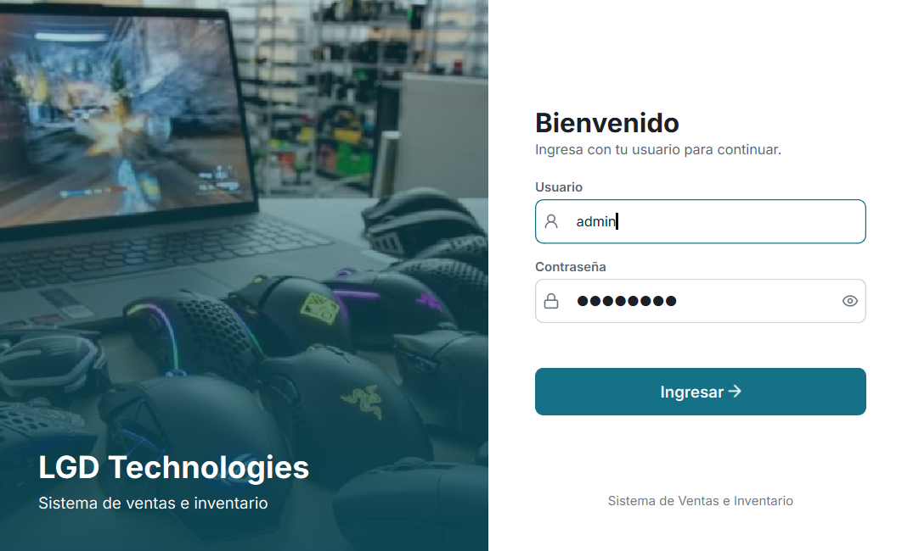 | 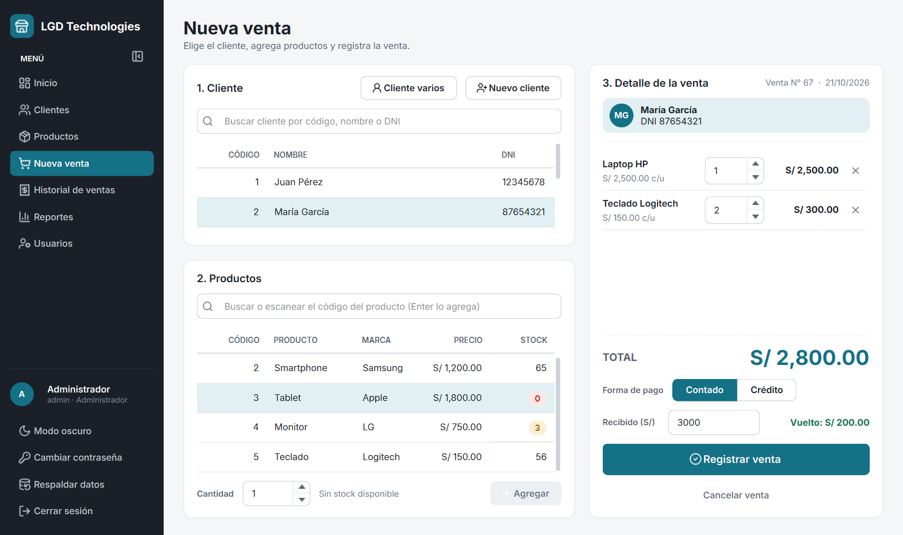 |

| Historial de ventas (con una venta anulada) | Reportes |
|:---:|:---:|
| 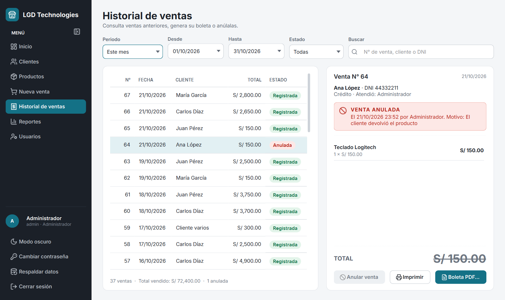 | 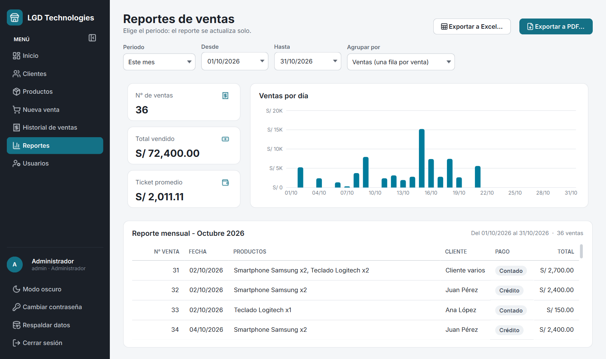 |

| Clientes | Productos |
|:---:|:---:|
| 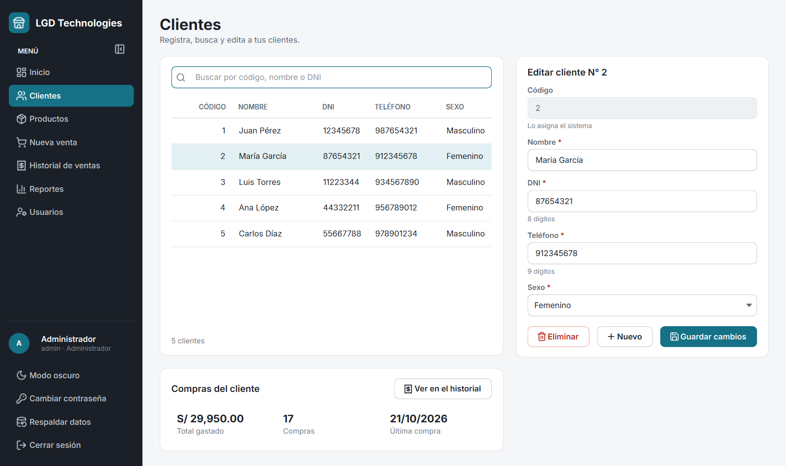 | 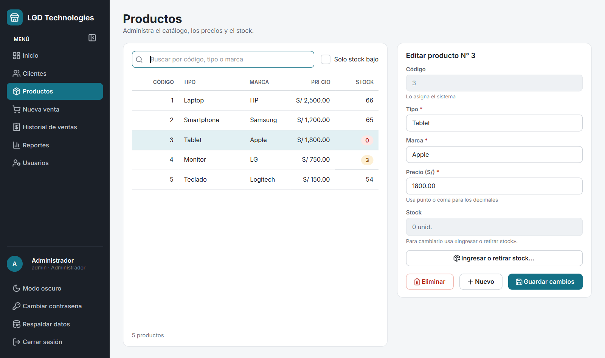 |

| Usuarios | Boleta en PDF |
|:---:|:---:|
| 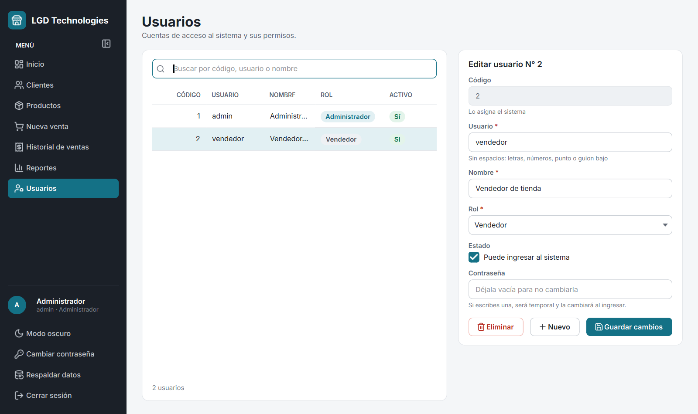 | 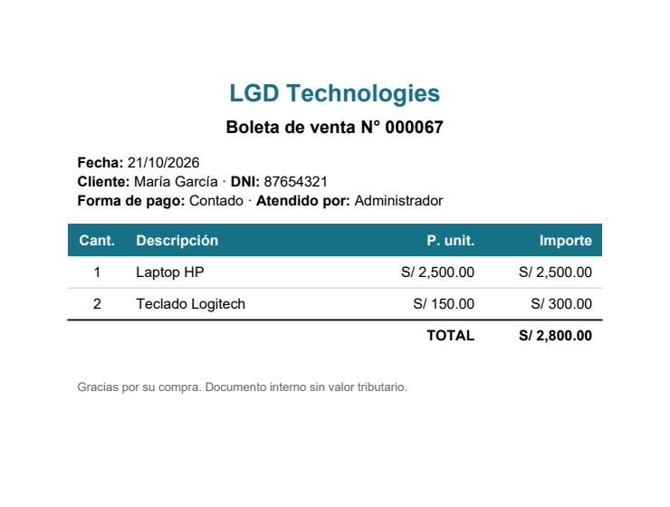 |

| Modo oscuro | Pantalla bloqueada por inactividad |
|:---:|:---:|
| 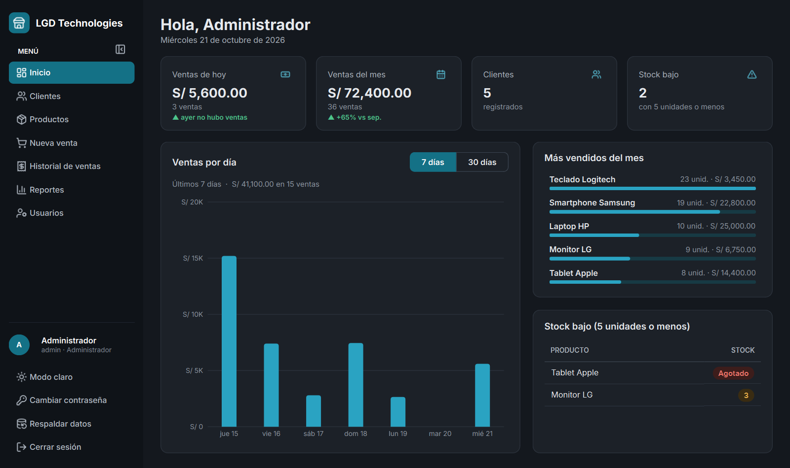 | 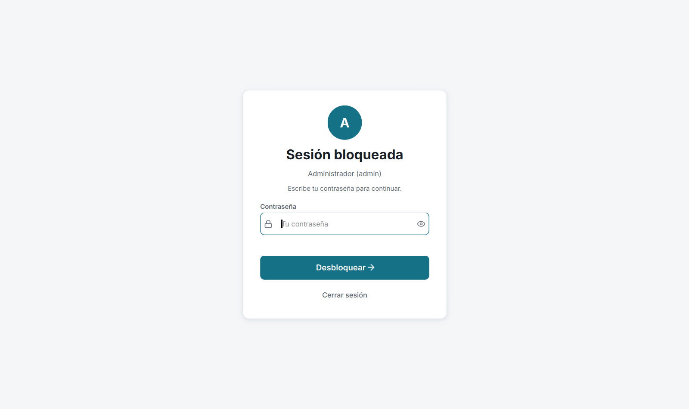 |

Reporte exportado a PDF:

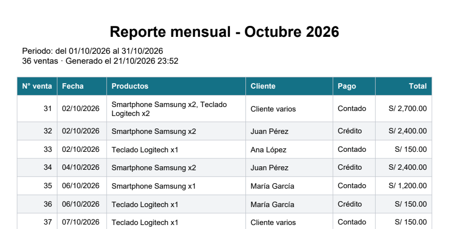

## Requisitos

- Python 3.12 (es la versión con la que se probó)
- MySQL 8.0.16 o superior (probado con 8.4)
- Las dependencias de [requirements.txt](requirements.txt): PyQt6, PyMySQL, reportlab, openpyxl y cryptography

## Instalación

1. **Clona el repositorio**

   ```bash
   git clone https://github.com/AcuLuis/SistemaVentas.git
   cd SistemaVentas
   ```

2. **Crea un entorno virtual e instala las dependencias**

   ```bash
   python -m venv .venv
   .venv\Scripts\activate        # Windows
   source .venv/bin/activate     # Linux / macOS
   pip install -r requirements.txt
   ```

3. **Crea la base de datos.** El primer script crea la base y sus tablas. El segundo carga datos de ejemplo y los usuarios iniciales.

   ```bash
   mysql -u root -p --default-character-set=utf8mb4 -e "source BD/bd_tienda_tecnologia.sql"
   mysql -u root -p --default-character-set=utf8mb4 -e "source BD/datos_bd.sql"
   ```

4. **(Recomendado) Crea un usuario de MySQL solo para la aplicación**

   ```sql
   CREATE USER 'tienda'@'localhost' IDENTIFIED BY 'una_contraseña_segura';
   GRANT ALL ON bd_tienda_tecnologia.* TO 'tienda'@'localhost';
   ```

5. **Configura la conexión.** Copia [config.ejemplo.ini](config.ejemplo.ini) como `config.ini` y completa tus datos. El archivo `config.ini` está en `.gitignore`, así que tus credenciales no se suben al repositorio.

   ```ini
   [mysql]
   host = 127.0.0.1
   port = 3306
   user = tienda
   password = una_contraseña_segura
   database = bd_tienda_tecnologia

   [sistema]
   ; Minutos sin uso antes de bloquear la pantalla (0 lo desactiva)
   bloqueo_minutos = 10
   ```

   La sección `[sistema]` es opcional: si no la pones, la pantalla se bloquea a los 10 minutos.

6. **Ejecuta la aplicación**

   ```bash
   python control.py
   ```

## Usuarios de ejemplo

| Usuario | Contraseña | Rol |
|---|---|---|
| `admin` | `admin123` | Administrador |
| `vendedor` | `vendedor123` | Vendedor |

> [!IMPORTANT]
> Estas contraseñas son públicas: al ingresar con ellas, el sistema te pide crear una nueva antes de continuar. Más adelante puedes cambiarla desde **Cambiar contraseña**, en la parte inferior del menú.

Cuando el administrador crea un usuario, o le pone una contraseña nueva desde **Usuarios**, esa contraseña es temporal: el usuario la reemplaza por una propia la primera vez que ingresa.

Qué puede hacer cada rol:

| Opción | Administrador | Vendedor |
|---|:---:|:---:|
| Inicio, Clientes, Nueva venta, Historial y boletas | ✅ | ✅ |
| Eliminar clientes | ✅ | — |
| Productos, Reportes y Usuarios | ✅ | — |
| Anular ventas | ✅ | — |
| Respaldar datos | ✅ | — |

## Atajos de teclado

| Atajo | Acción |
|---|---|
| `Ctrl+1` … `Ctrl+7` | Inicio, Clientes, Productos, Nueva venta, Historial, Reportes y Usuarios |
| `F2` | Nueva venta |
| `Ctrl+F` | Ir al buscador de la pantalla |
| `Esc` | Borrar la búsqueda |
| `Ctrl+N` | Nuevo cliente, producto o usuario |
| `Ctrl+S` o `Enter` | Guardar el formulario |
| `Enter` en el buscador de productos (o lector de código de barras) | Agregar el producto con ese código |
| `Enter` en la cantidad o doble clic en un producto | Agregarlo a la venta |

Haz clic en el encabezado de una columna para ordenar la tabla; un tercer clic vuelve al orden original.

## Respaldo y restauración

El administrador puede pulsar **Respaldar datos**, en la parte inferior del menú, para guardar una copia completa de la base de datos en un archivo `.sql`. El sistema te propone un nombre con la fecha y la hora, y la descripción del botón muestra cuándo fue el último respaldo. Guarda también una copia fuera de la PC, en un USB o en la nube.

Para restaurar un respaldo, crea la base de datos si no existe y carga el archivo:

```bash
mysql -u root -p -e "CREATE DATABASE IF NOT EXISTS bd_tienda_tecnologia CHARACTER SET utf8mb4"
mysql -u root -p --default-character-set=utf8mb4 bd_tienda_tecnologia < respaldo_bd_tienda_tecnologia_2026-10-21_1830.sql
```

> [!WARNING]
> Restaurar reemplaza las tablas con el contenido del respaldo: lo registrado después de esa fecha se pierde.

## Actualizar una base de datos anterior

Si creaste la base con una versión anterior de este proyecto, primero haz un respaldo:

```bash
mysqldump -u root -p bd_tienda_tecnologia > respaldo.sql
```

Luego ejecuta **una sola vez** la migración que corresponda:

- **Tu base no tiene la tabla `usuario`** (versión original): convierte las ventas al nuevo formato y crea el usuario `admin` / `admin123`.

  ```bash
  mysql -u root -p --default-character-set=utf8mb4 -e "source BD/actualizar_bd.sql"
  ```

- **Tu base ya tiene la tabla `usuario`**: habilita las ventas a «Cliente varios» y las contraseñas temporales.

  ```bash
  mysql -u root -p --default-character-set=utf8mb4 -e "source BD/actualizar_bd_2.sql"
  ```

## Crear un ejecutable (.exe)

```bash
pip install pyinstaller
pyinstaller SistemaVentas.spec
```

El ejecutable queda en `dist/SistemaVentas.exe`. Para distribuirlo, coloca un `config.ini` en la misma carpeta que el `.exe`.

## Estructura del proyecto

```text
SistemaVentas/
├── control.py             # Punto de entrada: lógica de pantallas, ventas, reportes y sesión
├── interfaz.py            # Ventanas y pantallas construidas con PyQt6
├── bd.py                  # Configuración, conexión y consultas parametrizadas a MySQL
├── seguridad.py           # Cifrado y verificación de contraseñas
├── BD/
│   ├── bd_tienda_tecnologia.sql   # Esquema de la base de datos
│   ├── datos_bd.sql               # Datos de ejemplo y usuarios iniciales
│   ├── actualizar_bd.sql          # Migración desde la versión original
│   └── actualizar_bd_2.sql        # Migración desde la versión con usuarios
├── iconos/                # Ícono de la aplicación y de los controles
│   └── lucide/            # Íconos de línea del menú y los botones
├── fuentes/               # Tipografía Inter (se incluye para verse igual en cualquier PC)
├── docs/img/              # Capturas usadas en este README
├── config.ejemplo.ini     # Plantilla de config.ini
├── SistemaVentas.spec     # Configuración para crear el .exe
└── requirements.txt
```

## Seguridad

- Todas las consultas SQL son parametrizadas, lo que evita la inyección SQL.
- Las contraseñas de los usuarios se guardan cifradas con PBKDF2-SHA256 y sal aleatoria.
- Las contraseñas de ejemplo y las temporales se cambian obligatoriamente al ingresar.
- La pantalla se bloquea tras un tiempo sin uso y solo la desbloquea el mismo usuario con su contraseña.
- Las credenciales de MySQL viven en `config.ini`, fuera del código y del repositorio.
- Los errores inesperados se muestran con un mensaje claro y se registran en `sistema_ventas.log`.

## Solución de problemas

- **"No se pudo conectar con MySQL":** verifica que el servidor esté encendido y que los datos de `config.ini` sean correctos.
- **"Base de datos desactualizada":** tu base se creó con una versión anterior. Haz un respaldo y ejecuta la migración que indica el mensaje (ver [Actualizar una base de datos anterior](#actualizar-una-base-de-datos-anterior)).
- **Tildes o símbolos raros al consultar desde la consola de Windows:** los datos están bien; es la consola la que no muestra UTF-8. Ejecuta `chcp 65001` y usa `mysql --default-character-set=utf8mb4`.
- **Otros errores:** revisa `sistema_ventas.log`, junto a `control.py` o al `.exe`. Ese archivo solo se crea si ocurrió algún error.

## Créditos

- Tipografía [Inter](https://rsms.me/inter/), bajo la licencia SIL Open Font License 1.1 ([fuentes/OFL.txt](fuentes/OFL.txt)).
- Íconos [Lucide](https://lucide.dev), bajo la licencia ISC ([iconos/lucide/LICENSE](iconos/lucide/LICENSE)).

## Contribuciones

¡Las contribuciones son bienvenidas! Para proponer un cambio:

1. Haz un fork del repositorio.
2. Crea una rama: `git checkout -b feature/nueva-funcionalidad`
3. Haz tus cambios y un commit: `git commit -m "Añade nueva funcionalidad"`
4. Sube la rama: `git push origin feature/nueva-funcionalidad`
5. Abre un Pull Request.

## ⭐ ¿Te gustó el proyecto?

Si este sistema te resultó útil, te sirvió para aprender o simplemente te gustó, **me harías muy feliz regalándole una estrella** ⭐ al repositorio. Es un gesto pequeño que me anima a seguir mejorándolo y a compartir más proyectos.

[](https://github.com/AcuLuis/SistemaVentas)

¡Gracias por pasar por aquí! 🙌

## Licencia

Este proyecto está bajo la licencia MIT. Consulta el archivo [LICENSE](LICENSE) para más detalles.

## Contacto

Si tienes alguna pregunta o sugerencia, escríbeme a luisacudev@gmail.com.
